

  

  <a href="https://www.linkedin.com/in/jyotheshkarnam/"><strong>LinkedIn ↗</strong></a> &nbsp; · &nbsp;
  <a href="#selected-systems">Explore the code</a> &nbsp; · &nbsp;
  <a href="mailto:jyotheshkar@gmail.com">Email</a>

### From model evaluation to dependable agent workflows

I'm **Jyothesh**, a London-based developer focused on **Agentic AI engineering**: tool orchestration, retrieval, state, human review and evaluation. My independent projects turn those interests into code, reproducible checks and explicit engineering decisions.

At **Amazon AGI Data Services**, I work as a **Machine Learning Data Associate II** (June 2025–present), evaluating foundation-model outputs through structured scoring, failure investigation and multimodal red/blue-team review. Since February 2026, my work has included verifying peer red/blue-team evaluations across sites.

**MSc Computer Science, Distinction — Keele University** · Best Performance Award, School of Mathematics and Computer Science.

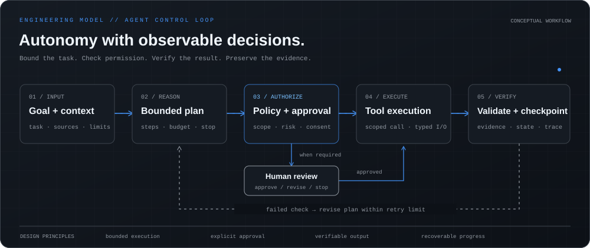

### Selected systems

Start with **Agentic Core** for workflow controls, **Rufus Eval Engine** for retrieval and evaluation, and **Atlas** for evidence and provenance. Each card links directly to its repository.

  <a href="https://github.com/jyotheshkar/agentic-core-evidence">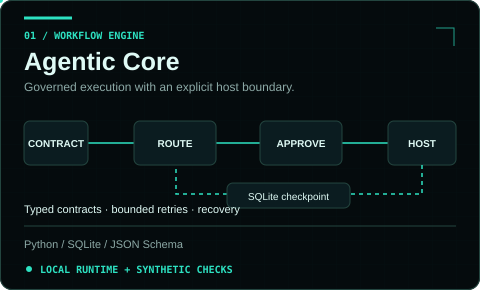</a>
  <a href="https://github.com/jyotheshkar/Rufus-Eval-Engine">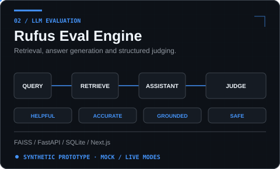</a>
  <a href="https://github.com/jyotheshkar/Atlas">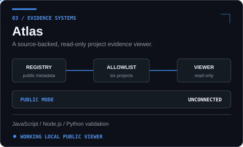</a>
  <a href="https://github.com/jyotheshkar/system-architecture-workspace">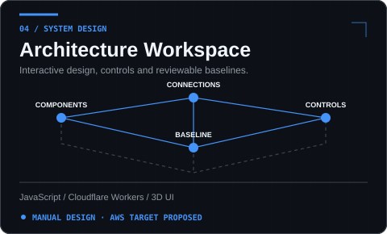</a>
  <a href="https://github.com/jyotheshkar/nhs-elective-flow-intelligence">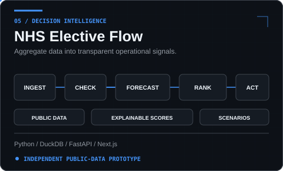</a>
  <a href="https://github.com/jyotheshkar/PrimeLift">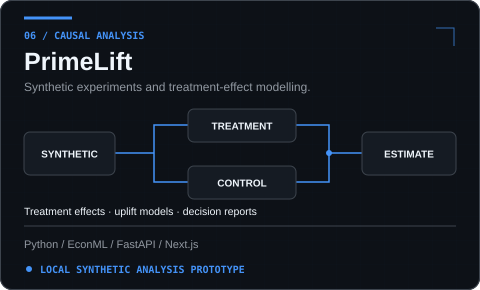</a>

<strong>Implementation notes and evidence</strong>

| System | What is implemented | Scope to keep in mind |
|---|---|---|
| [Agentic Core](https://github.com/jyotheshkar/agentic-core-evidence) | Sequential Python runtime, typed contracts, SQLite checkpoints, bounded retries and uncertain-outcome reconciliation | Reasoning and tools come from the host; proposed AWS architecture is a design. [Dated synthetic verification](https://github.com/jyotheshkar/agentic-core-evidence/blob/main/docs/verification/2026-11-10-maintenance.md). |
| [Rufus Eval Engine](https://github.com/jyotheshkar/Rufus-Eval-Engine) | Retrieval → assistant → judge pipeline, scoring rubrics, API and dashboard source | Fixed mock scores demonstrate wiring, not measured model quality; live API behavior requires separate validation. |
| [Atlas](https://github.com/jyotheshkar/Atlas) | Public project registry, evidence viewer, provenance and route/privacy checks | Public build is explicitly unconnected to live career/provider adapters. |
| [Architecture Workspace](https://github.com/jyotheshkar/system-architecture-workspace) | Sanitized application export, manual component design, connection inspection and architecture baselines | Prompt-to-design assistant is future work; AWS targets are proposals. |
| [NHS Elective Flow](https://github.com/jyotheshkar/nhs-elective-flow-intelligence) | Public aggregate-data ingestion, transparent scoring, forecasting and capacity scenarios | Independent prototype; no patient data, NHS affiliation or clinical deployment. Hosted end-to-end availability is unverified. |
| [PrimeLift](https://github.com/jyotheshkar/PrimeLift) | Synthetic data generation, treatment-effect models and saved decision reports | Interface is partly integrated; model selection reuses the split named test, so no untouched final-evaluation claim. |

All featured work is independent of my employment. Rufus Eval Engine is an independent shopping-assistant evaluation project, not an Amazon product. Public source does not establish production deployment or live integrations.

### Engineering toolkit

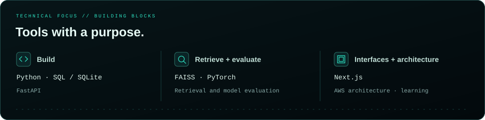

I design around **explicit contracts, bounded tool use, durable state, human approval and inspectable evidence**. I care about how a system fails, how it recovers, and whether its results can be checked.

Supporting cloud studies: [AWS Bedrock RAG lab](https://github.com/jyotheshkar/jyotheshkar-RAG-Based-AI-Chatbot-with-AWS-Bedrock) · [AWS three-tier architecture lab](https://github.com/jyotheshkar/AWS-Three-Tier-Web-Application-). These preserve guided learning and design artifacts, with their implementation limits documented.

### Public GitHub telemetry

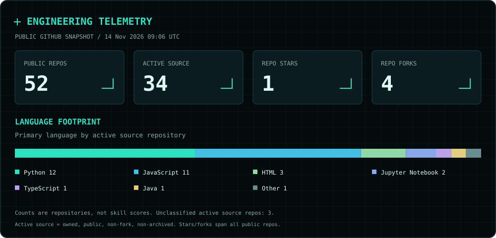
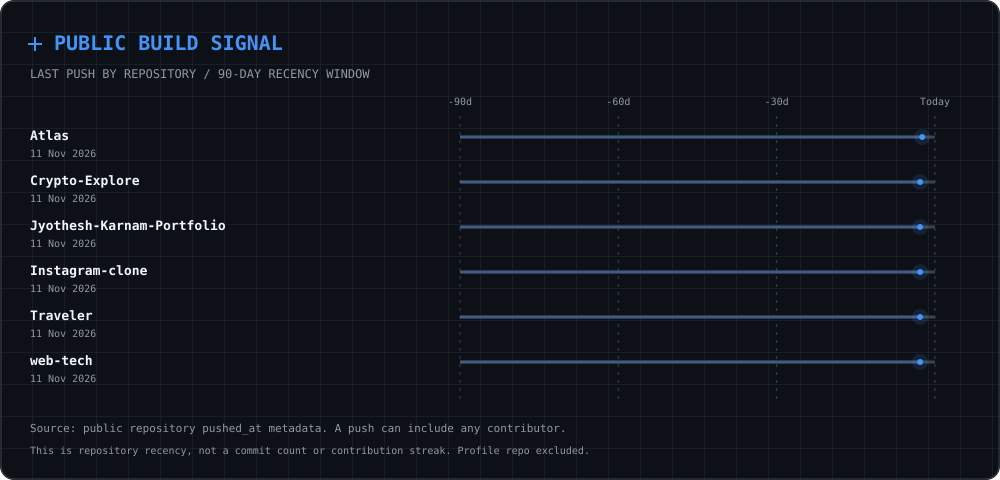

Generated from public repository metadata; capture time and scope appear in each panel. [Metric definitions and refresh](docs/profile-maintenance.md). GitHub's native contribution calendar appears below this profile.

<a href="https://www.linkedin.com/in/jyotheshkarnam/"></a>

<strong>Open to AI Engineer / Agentic AI Engineer opportunities.</strong> 
<a href="https://www.linkedin.com/in/jyotheshkarnam/">LinkedIn</a> · <a href="mailto:jyotheshkar@gmail.com">jyotheshkar@gmail.com</a>

[Architecture and maintenance](docs/architecture.md) · [Archived learning projects](docs/archived-projects.md) · [Profile visual system](docs/profile-maintenance.md)
