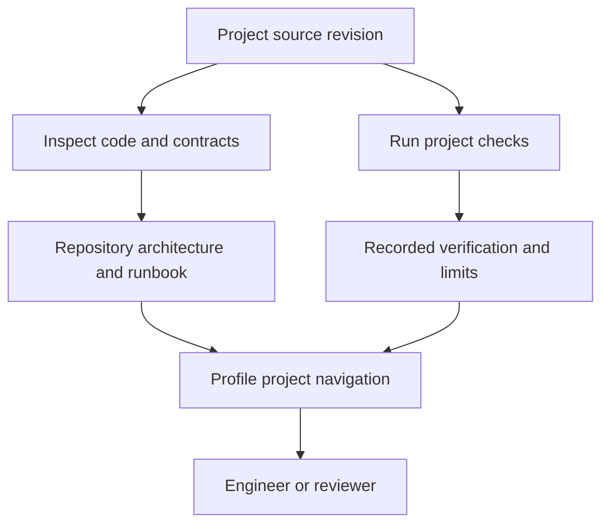

# Portfolio architecture and maintenance

Reviewed 11 November 2026. This repository is the GitHub profile and navigation
layer. It contains Markdown, not an application server or a shared runtime for
the linked projects. Each application keeps its own architecture, dependencies,
tests and limitations in its own repository.

## Boundaries and decisions

| Layer | Responsibility | Update rule |
|---|---|---|
| Individual repositories | Implement behavior and own dependencies | Fix concrete defects with regression coverage where behavior changes. Preserve academic and guided-learning provenance. |
| Architecture documents | Explain components, data flow, trust boundaries and storage | Map diagrams to actual source paths. Mark proposed infrastructure and unfinished scaffolds. |
| Verification evidence | Record checks that actually ran | Distinguish local tests, hosted CI, deployment verification and load testing. Never infer deployment or throughput from a diagram. |
| This profile | Link the current public evidence | Keep private source and operational data out. Do not copy stale test counts into the profile. |
| Historical projects | Preserve archived learning work | Record limitations separately; an archive is not a production-ready deliverable. |

The profile now links Atlas rather than the former unavailable Quasar path. Agentic
Core's test count is kept in its own evidence instead of duplicated here, where it
could become stale.

## Scalability

GitHub renders this Markdown; this repository has no database, queue or autoscaling
configuration. Its maintainability constraint is evidence freshness and accurate
navigation. The linked services require independent load tests and operational
decisions. A successful unit suite or a scaling plan alone cannot establish their
production capacity.

For application maintenance, first reproduce a failure, identify the owning module,
make the smallest sufficient repair, run the relevant checks and review the exact
diff. Preserve a known revision for rollback. Change one project's dependency or
storage boundary deliberately rather than imposing a shared framework on unrelated
learning projects.

## Verification

This change updates documentation and navigation only. Relative Markdown links
and the diff are checked locally. No hosted applications, live cloud resources,
private integrations or archived repositories are changed by this profile update.
