# Archived public learning projects

Inspected 11 November 2026. These repositories were already archived. They remain
read-only and are not counted as repaired or production-ready. The diagrams below
summarize source structure, not verified running deployments. Empty repositories
have no implementation architecture to infer.

| Repository | Inspected source | Finding and maintenance requirement |
|---|---|---|
| NumCounter | `index.html`, `app.js`, `style.css` | DOM counter. The event registration is misspelled `addEvenetListner`; buttons cannot register handlers. |
| Jk-properties-Real-Estate | `index.html`, `package.json`, `src/style.css` | Static Tailwind learning site. HTML references `style.csss` and `/public/images/` while assets are in `images/`; build output and HTML paths disagree. |
| Supercorp-admin | `index.html`, `package.json` | Static admin mockup with Chart.js. `/public/images/` paths disagree with the tree; Tailwind build output differs from the linked stylesheet. No admin backend is present. |
| Complex-counter- | `App.js`, `useState-counter.js` | React hook exercise. App imports a missing tutorial path; no package manifest or HTML entry is committed. |
| javascript-basic-projects | README and recursive tree | Guided course exercises with separate `setup` and `final` directories. Preserve instructor attribution and intentionally incomplete exercises. |
| live-sessions | Recursive tree and `August/03-08-22/maxProfit.js` | Standalone JavaScript learning snippets, not one deployable service. Test each exercise independently with inputs and expected outputs. |
| react-covid-tracker | `src/App.js`, `src/LineGraph.js` | Browser API dashboard. Worldwide selection reads absent `countryInfo` coordinates; fetches lack failure handling. Data freshness is external and unverified. |
| Token-Generator-Application | `src/App.js` | React state-based token UI; no production queue or shared transactional storage is established. |
| React-weather-app | `App.js` and tree | React weather exercise with flat source layout. Manifest and entry paths need reconciliation before claiming a reproducible build. |
| To-do-List | `src/App.js`, `src/TodoList.js` | Local React task interactions; no shared backend or multi-user persistence established by inspected source. |
| Stable-Diffusion-Dreams | `App.js` and tree | React/canvas image-sequence concept with asynchronous generation. No package manifest or server implementation is committed; review cancellation and bounded image memory before resuming it. |
| interview-help | `sde-interview-prep.md` | Collected learning notes, not an application. Preserve original author attribution; it is not evidence of the profile owner's claimed interviewing experience. |
| My-Portfolio | Git tree endpoint | Empty Git repository. No application architecture can be verified. |
| thrive-shine-website | Git tree endpoint | Empty Git repository. No application architecture can be verified. |
| Jyothesh-Karnam-Portfolio-2026 | `README.md` | Title-only placeholder; no application source is present. |

## Source structures

### NumCounter

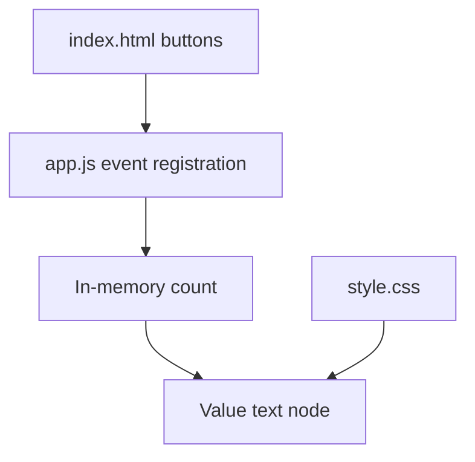

### Jk-properties-Real-Estate

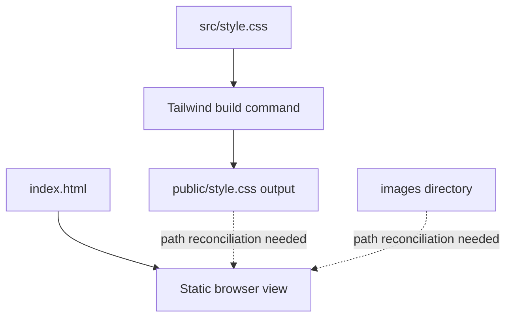

### Supercorp-admin

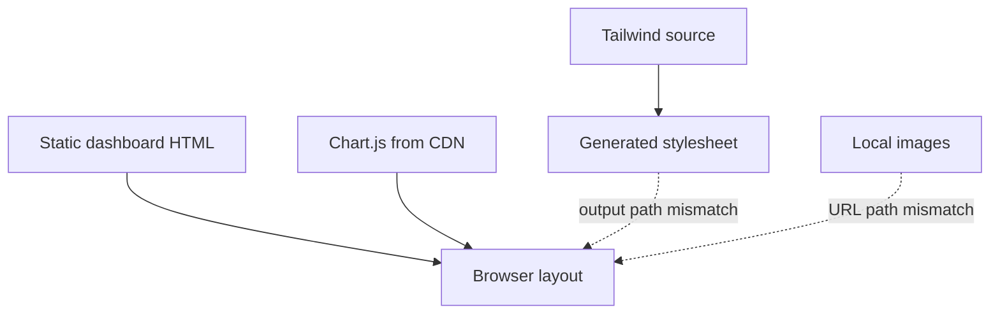

### Complex-counter-

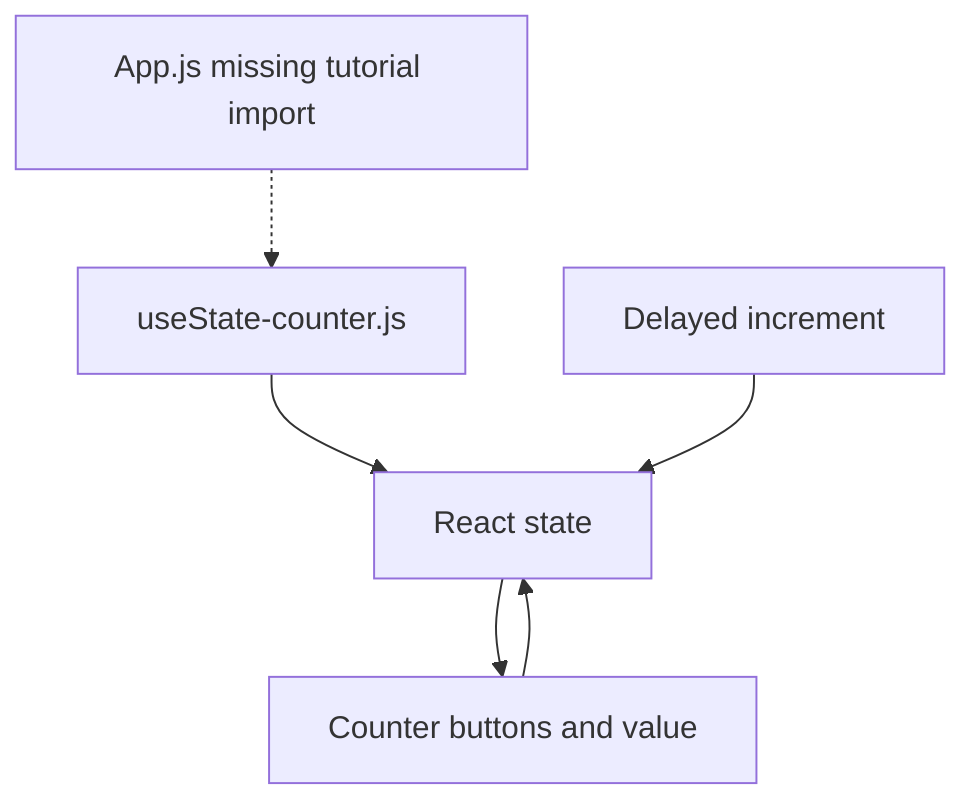

### javascript-basic-projects

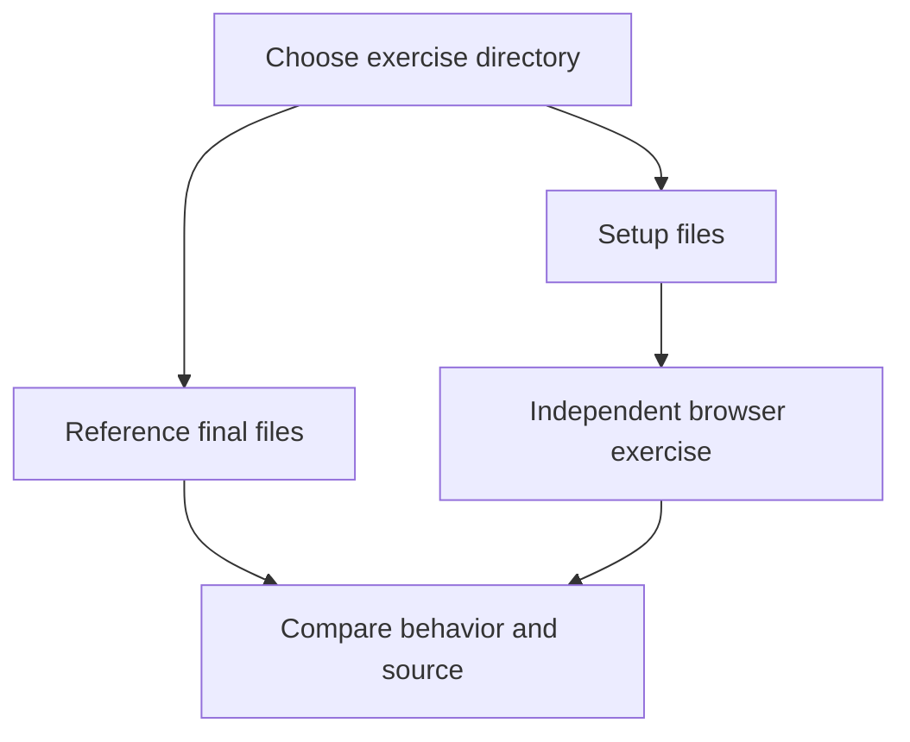

### live-sessions

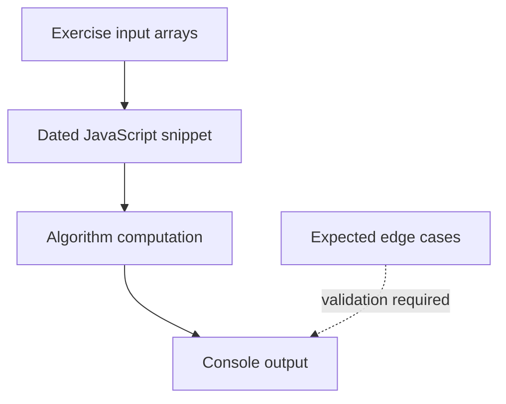

### react-covid-tracker

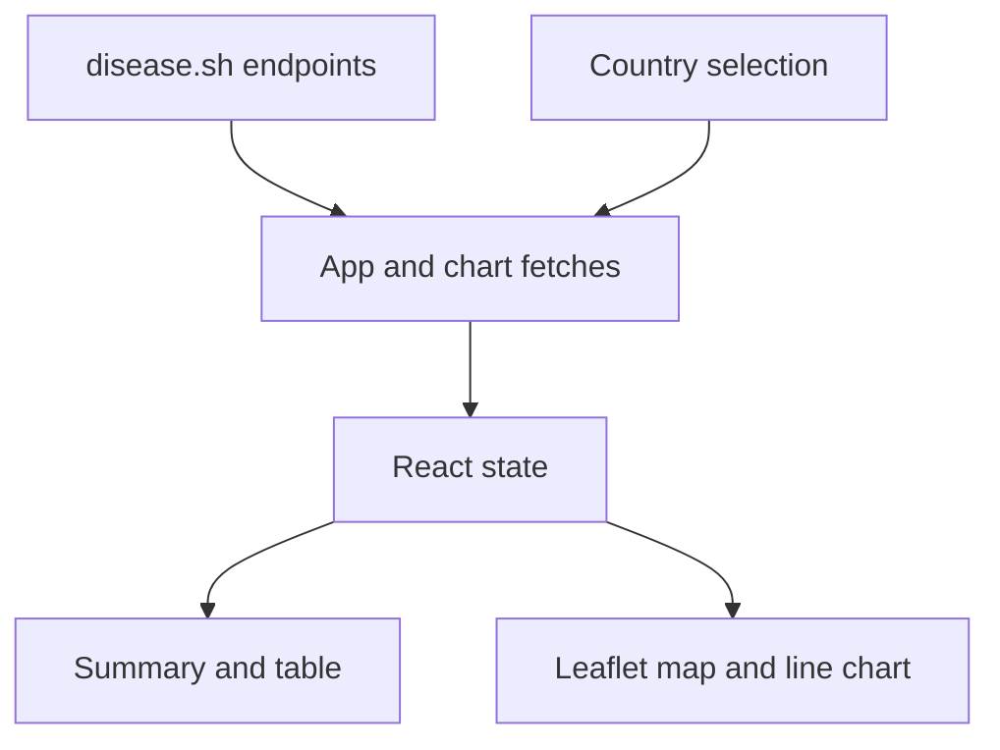

### Token-Generator-Application

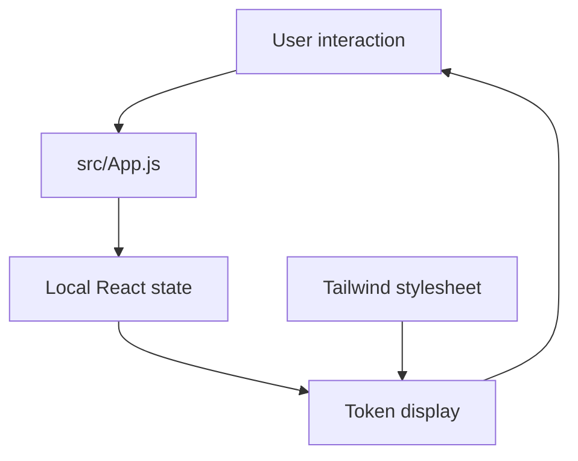

### React-weather-app

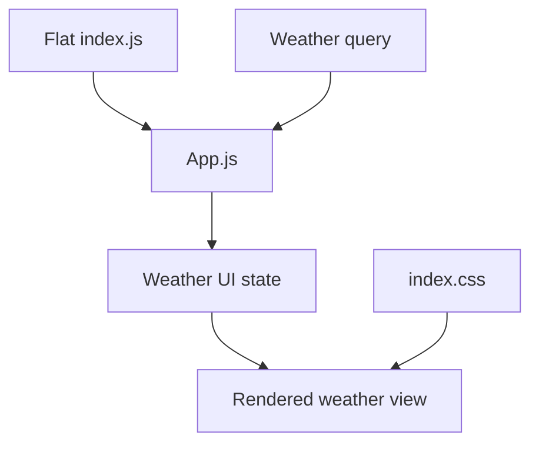

### To-do-List

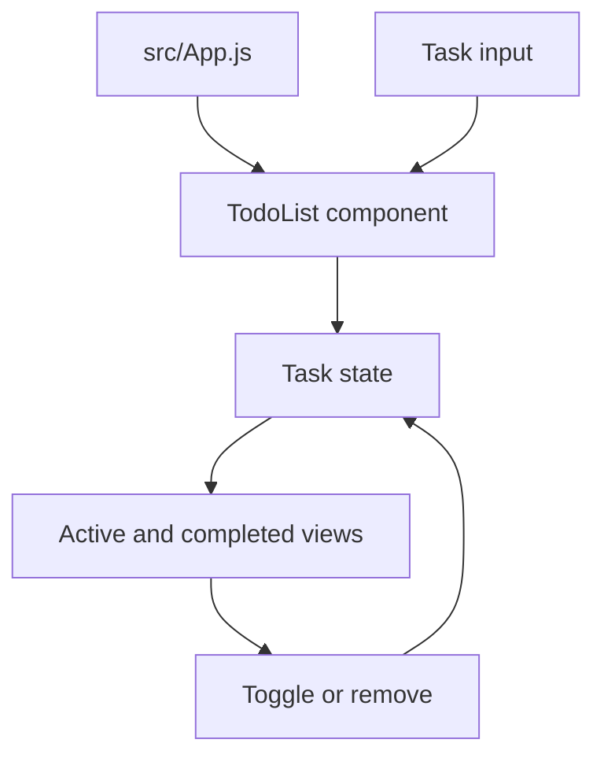

### Stable-Diffusion-Dreams

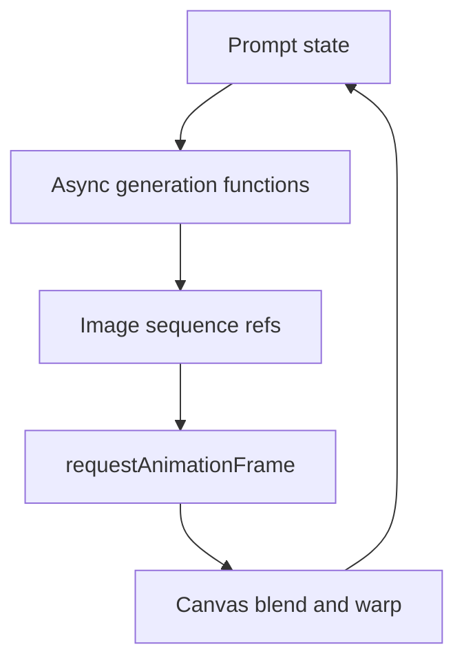

The archived notes and empty/title-only repositories intentionally have no invented
service diagram. No archived code was changed, rebuilt, or load-tested in this pass.
